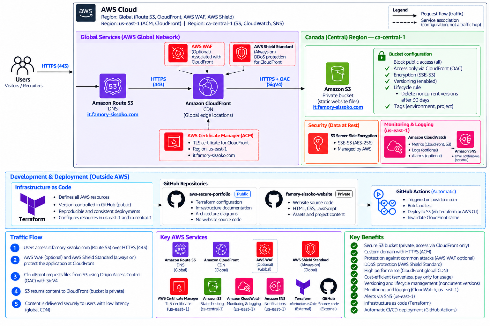

# AWS Secure Portfolio

**Author:** Famory Sissoko  

A secure, serverless, and cost-optimized professional portfolio website hosted on AWS, with infrastructure provisioned using Terraform and a deployment pipeline prepared using GitHub Actions.

## Architecture

The solution uses Amazon CloudFront to deliver static website content from a private Amazon S3 bucket, with Amazon Route 53 for DNS and AWS Certificate Manager (ACM) for HTTPS.

**Custom domain:** `it.famory-sissoko.com`

The infrastructure is primarily deployed in AWS Canada (Central), `ca-central-1`, with supporting services in `us-east-1`.



## AWS Services & Technologies

| Service / Technology | Purpose |
|---|---|
| Amazon S3 | Private storage for static website files |
| Amazon CloudFront | Global content delivery network |
| Amazon Route 53 | DNS and custom domain configuration |
| AWS Certificate Manager | TLS certificate for HTTPS |
| AWS IAM | Least-privilege access control |
| Amazon CloudWatch | CloudFront 5xx error monitoring |
| Amazon SNS | Email notifications for CloudWatch alarms |
| AWS Budgets | Cost monitoring and budget alerts |
| AWS Shield Standard | Built-in DDoS protection for CloudFront |
| Terraform | Infrastructure as Code |
| GitHub Actions | Automated CI/CD pipeline using AWS OIDC authentication |

## Security

- **Private S3 bucket:** Public access is blocked, with read access restricted to CloudFront using Origin Access Control (OAC).
- **HTTPS – Encryption in transit:** Secures communication between visitors and CloudFront using TLS and an ACM certificate for the custom domain.
- **Encryption at rest:** S3 server-side encryption using SSE-S3 (AES-256).
- **IAM least privilege:** Deployment role restricted to the required S3 and CloudFront operations.
- **Keyless authentication:** GitHub Actions uses OIDC and temporary AWS credentials instead of long-lived access keys.
- **DDoS protection:** AWS Shield Standard protection for CloudFront.

## Monitoring & Cost Optimization

- CloudWatch alarm monitors CloudFront 5xx error rates.
- Amazon SNS delivers email notifications when the alarm triggers.
- AWS Budgets provides cost threshold alerts.
- S3 versioning protects against accidental overwrites.
- Lifecycle policy removes noncurrent object versions after 30 days.
- Optional AWS WAF and access logging are deferred to avoid unnecessary costs.

## Repository Structure

```text
aws-secure-portfolio/
├── docs/                 # Architecture diagrams and documentation
├── terraform/            # AWS infrastructure configuration
├── .gitignore
└── README.md
```

Website source code is maintained separately in a private repository.

## Deployment

The website is automatically deployed to Amazon S3 through a GitHub Actions CI/CD pipeline whenever changes are merged into the `main` branch. The pipeline then creates a CloudFront cache invalidation to ensure visitors receive the latest content.

GitHub Actions authenticates to AWS using OIDC and temporary IAM credentials, eliminating the need for long-lived AWS access keys.

## Infrastructure as Code

AWS infrastructure is managed using Terraform, enabling reproducible provisioning, consistent configuration, and version-controlled infrastructure changes.

The Terraform configuration manages the S3 bucket and its security settings, CloudFront distribution, Route 53 DNS records, ACM certificate, CloudWatch monitoring, SNS notifications, and IAM resources for GitHub Actions.

## Architecture Documentation

Detailed architecture diagrams, security decisions, and implementation notes are available in the `docs/` directory.